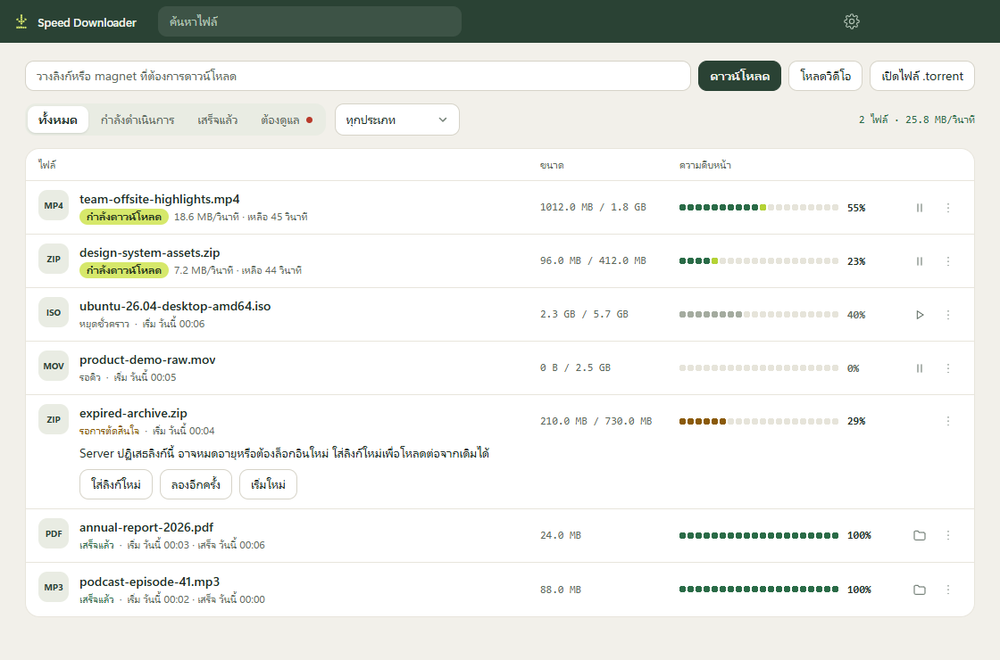

# Speed Downloader

A download manager for Windows, built with Electron, aria2 and yt-dlp. It handles HTTP, HTTPS, BitTorrent magnet links, `.torrent` files, and video pages without DRM.



The research behind its next features is in [docs/research](docs/research/README.md) (Thai).

## Install and open

Run `release\SpeedDownloader-Setup-1.6.3.exe`. It installs for the current Windows user and includes aria2 and yt-dlp. The installer is not code-signed, so Windows SmartScreen may warn the first time it runs.

Open the app from any of these:

- The Start menu or the **Speed Downloader** desktop shortcut.
- The tray icon, once it is running. It may be under the **^** arrow on the taskbar.

Closing the window frees its memory and keeps the app and its downloads running in the system tray. When a browser hands over a file while the window is closed, a notification appears, and clicking it opens the window. To start the app with Windows, turn on **Start with Windows** in Settings.

## Tray

Click the icon to open the window. Its colour shows the state: neutral when idle, green while downloading, amber when downloads are paused or waiting, and a red dot when something needs you. When a file starts downloading, the icon blinks a few times, its row in the list flashes, and the taskbar button flashes if the window is open behind other windows.

Right-click for the menu:

| Item | What it does |
|---|---|
| Status | Shows files and speed, the scheduled start if waiting, and how many downloads need attention. Click the attention line to see them |
| Open Speed Downloader | Opens the window |
| Add link | Adds the web address or magnet link on the clipboard, if there is one |
| Pause all, Resume all | Available when there is something to pause or resume |
| Recent files | The last five finished files. Click one to show it in its folder |
| Open downloads folder | Opens the folder files are saved to |
| Take downloads from the browser | Turns browser capture on or off |
| Download only during set hours | Turns the schedule on or off |
| Settings | Opens the Settings page |
| Quit | Stops all downloads and exits |

## Update

Run the newer `SpeedDownloader-Setup-x.y.z.exe` over the installed app, without uninstalling. The installer closes a running app, so unfinished downloads stop, and they continue when you open the app again. Your list and settings are kept, including settings whose default has changed in the new version. Open the app afterwards, because the browser connection is registered again when it starts. If the extension changed, click **Reload** on it in `chrome://extensions` or `edge://extensions`.

To make a new version, raise `version` in `package.json` and run `npm run package`. There is no automatic update.

## Connect Chrome or Edge

The installed app registers its browser connection each time it starts. The extension still has to be loaded by hand, because it is not in the Chrome Web Store or Edge Add-ons:

1. In the app, open **Settings** and click **Open folder** next to **Install the extension**.
2. Open `chrome://extensions` or `edge://extensions` and turn on **Developer mode**.
3. Click **Load unpacked** and choose the folder that opened.

Turn off other download manager extensions, such as IDM's. Otherwise both try to take the same file.

Common video, audio, document, program and archive files go to the app, and you can add more types in Settings. The browser keeps the download when the file is small, when the app cannot fetch the same file (single-use links, POST downloads), when the window is private, or when the app does not answer in time.

To let one file stay in the browser, click the Speed Downloader icon on the browser toolbar first. The badge shows **SKIP**, and the next file within one minute is left alone. Click the icon again to cancel. After updating the app, reload the extension from the extensions page, because it needs new permissions for this.

## Turn off when done

Turn on **Turn off the computer when done** under **Settings > Downloads** or in the tray menu. A label on the main page shows while it is on. Once a file finishes and nothing is left running or queued, a message gives you 60 seconds to cancel, and then the computer turns off. Paused files are not waited for, and files that failed do not stop it. The option applies once, turns itself off afterwards, and is off whenever the app starts. Windows is not forced to close other programs, so one with unsaved work can hold the shutdown back.

## Folders by file type

Under **Settings > Folders by file type**, choose a folder for video, audio, documents, programs, archives, other files or torrents. A type without a folder goes to the main folder. This applies to newly added files, and files already started stay where they are.

## Schedule

Turn on **Download only during set hours** under **Settings > Schedule**. Outside those hours downloads wait in the queue, and running ones go back to the queue and continue the next time. Choose **Start now** from a download's **...** menu to run it anyway. The computer must be on and the app running, including in the tray.

## Video

In Chrome or Edge, a **Get video** button appears beside a video once it starts playing or the pointer reaches it. Click it to choose a quality and see each file's size, and the file goes to the app. A size marked `~` is an estimate, from the site or from the video's bit rate and length, so the real file can differ. The button does not appear on small videos or videos using DRM, and **Hide on this page** removes it until the page reloads.

The extension also watches the requests a page's player makes for HLS (`.m3u8`), DASH (`.mpd`) and video files, so it can find a video on sites yt-dlp does not know. If it sees such a request but cannot find the video on the page, the button waits in the top right corner. These addresses stay in the browser's memory for that tab. Nothing leaves the browser until you click, and then the app receives the address with the browser's referrer, user agent and the cookies for that address's site. Cookies are kept encrypted in the app's list where Windows allows it, and are written to a temporary file only while yt-dlp runs. Videos using DRM are still refused, and some sites tie an address to the browser so that it cannot be fetched from outside it.

You can also paste the address of a video page in the app and click **Get video**. This uses [yt-dlp](https://github.com/yt-dlp/yt-dlp). Videos with DRM, live streams and videos that need a login are refused with an explanation. If `ffmpeg` is on your `PATH`, the app gets the highest quality by combining separate picture and sound. Without it, the app uses the best single file the site offers, which is often lower quality. Sites change often, so a site may stop working until yt-dlp is updated. Only download what you have the right to.

## BitTorrent

Paste a magnet link into the address box, or click **Open .torrent file**. Downloads stop when the files are complete, so the app does not keep uploading afterwards.

While a torrent is downloading, your IP address is visible to other peers and pieces are uploaded to them. Windows Firewall may ask about `aria2c.exe` the first time. Only download what you have the right to.

## Moved or deleted files

If a finished file is no longer where it was saved, clicking **Open file** or **Show in folder** says so on its row and offers **Download again** or **Remove from list**. A download link may have expired by then, and the row explains this if so.

## Files from the internet

Like a browser, the app marks each finished file as downloaded from the internet, so Windows SmartScreen checks programs and Office opens documents in Protected View. The mark records only the site and path the file came from, without the part after `?`, which can hold sign-in tokens. Files on disks that cannot hold the mark, such as FAT32 or exFAT, stay unmarked. If an administrator has turned off "Do not preserve zone information in file attachments", the app follows that and marks nothing.

## Language

Choose Thai or English under **Settings > General**. The first run follows the Windows language.

## Develop

Requires Node.js 26 and aria2 (`winget install aria2.aria2`).

```bash
npm install
npm run setup-browser
node scripts/fetch-yt-dlp.mjs
npm start
```

In a development run, double-click `native-host\register.cmd` in File Explorer to connect the browser.

## Test

| Command | What it covers |
|---|---|
| `npm test` | Core logic, including real aria2, a local server, and BitTorrent on loopback |
| `npm run smoke` | The real window from start to finish. Moves one small test file to the Recycle Bin |
| `npm run build`, then `electron test/worst-case-main.cjs` | The interface with worst-case data at several sizes |
| `npm run build`, then `electron test/quality-main.cjs` | Contrast, control sizes, names and keyboard focus in the real window, in both themes |
| `npm run build`, then `electron test/missing-file-main.cjs` | What buttons say when they cannot do their job, such as a moved file or a bad link, in the real window |
| `node test/edge-check.mjs` | The browser hand-off in Edge with a temporary profile |
| `node test/browser-check.mjs` | A page for checking the hand-off by hand in any browser |

## Build the installer

```bash
npm run package
```

The installer is written to `release`. On a new copy of the project, run `npx electron --version` once first, because Electron downloads itself the first time it runs and the installer is built from that download.

## Licence note

This project's own code is under the [MIT licence](LICENSE). aria2 and yt-dlp are separate programs under their own licences, and this repository does not contain them.

The installer includes aria2, which is licensed under GPL-2.0-or-later. Its licence and a link to its source are in `resources\aria2-licence` in the installed folder. Check what this requires before distributing the installer to other people. It also includes yt-dlp, unmodified; `yt-dlp-SOURCE.txt` in the same folder links to its release, which lists its licences.
